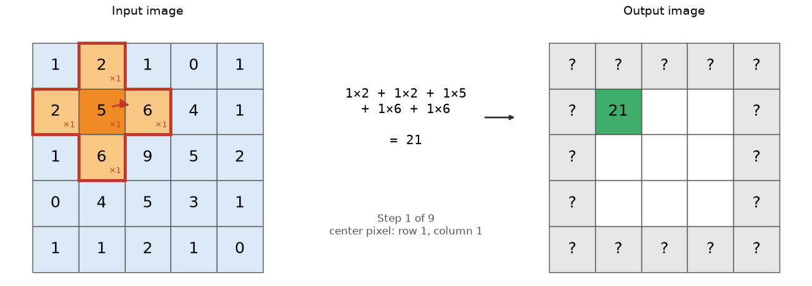
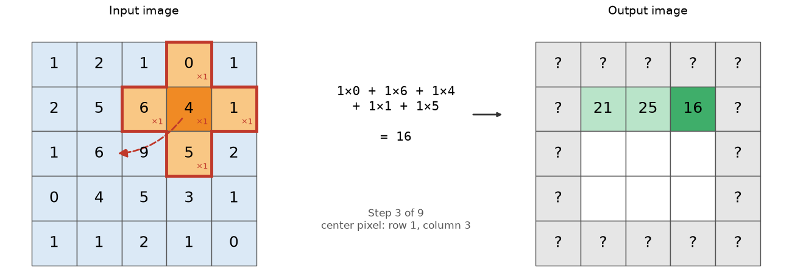

# Image filters and how they work

## Introduction
Image filters are used to reduce noise in the image, to sharpen borders, or to do things like blurring objects. They are still an important tool in the arsenal of possible image transformations that you can apply.  Image filters take an input image and produce an output image (even though your software may replace the input image on the screen with the output image). There are two fundamentally different forms: one where you can re-create the input image (given the output image and the filter), and one where that is not possible. In addition, there are filters that act globally on the whole image, and there are filters that act locally, and that are applied section by section on the whole image.  In this session, we will limit ourselves to these "local filters".

## Local filters, what is in the neighborhood?
Local filters use a "structuring element".  That "structuring element" will be laid over the pixel values (starting at the origin of the image), and the recipe defined by the structuring element will be applied to calculate a value for the central pixel under the structuring element in the output image. Then, the structuring element will move to the next pixel, the procedure will be repeated, etc.  Let's start with an example.

Below is a 5 x 5 image and a 3 x 3 structuring element that is missing its 4 corners, so it has the shape of a plus sign. A structuring element does not have to be square: only the pixels that are part of its shape take part in the calculation.  Each of those pixels has a weight (here all weights are 1, shown as "×1").

To calculate one output pixel:
1. Place the center of the structuring element (dark orange) on a pixel of the input image.
2. Multiply each input pixel under the structuring element (light orange) by its weight.
3. Add up the results.  The sum is the value of the output pixel at the position of the center pixel (dark green).

Then move the structuring element one pixel to the right (dashed arrow) and repeat.  The pixel values of the input image do not change; the results go into a new, output image.

At the end of a row, jump back to the start of the next row:

Continue until every pixel has been visited.  The animation shows all steps:

Notice that the pixels at the edge of the output image are marked "?".  When the center sits on an edge pixel, part of the structuring element falls outside the image, so there are no input values to multiply with.  Software has to make a choice here, for instance by pretending that the pixels outside the image are zero, or copies of the edge pixels.  Different choices give slightly different results at the image border.

* The pictures above were made with `uv run src/convolution_demo.py`.  Ask your AI coding assistant to change the weights in the structuring element (for instance, 4 in the center and -1 for the 4 neighbors) and run the script again.  What happens to the output values?  What do you need to change to calculate the average of the 5 pixels instead of the sum?

* Can you calculate the input image based on the output image and the structuring element (which often is called "kernel"?  If so, how would you do it?  

## Non-reversible filters: Median filter to reduce noise
A median filter will calculate the median of the pixels under the structuring element and place that value in the output image. Median filters are usually very good at removing "salt and pepper" noise (noise with a small portion of the pixels having outlier values).  Median filters will cause loss of some detail in the image.

* Open the image "testImages/Nucleu_cropped_noise.tif" in napari and inspect the image.  Ask your AI assistant to write a script that generates versions of this image with a median filter build from  a 3x3 kernel missing the corners, a 3x3 kernel, and a 5x5 kernel. Open these in napari and compare the effects of the different median filters. What happens to the noise, and what happens to the structure within the nucleus with these different filters.

## Smooth filter: A simple reversible filter to smooth and reduce noise.
A 3x3 filter with all weights at 1 will "smooth' the image.  This is the ImageJ/Fiji Smooth filter.  To preserve structure a little better, you can increase the weight of the central pixel of the kernel to a higher value (such as 4).

* Ask your coding asistant to write a Python script to apply the following kernels on your Nucleu_cropped_noise.tif:  a 3x3 kernel with all ones, a 3x3 kernel with all ones, except for the central pixel being 4, a 7x7 kernel with all ones. Normalize each kernel by its sum. Compare the output images with each other, and with the median filtered images.

# Sharpen filter: accentuate fine details
The kernel of teh Sharpen filter in ImageJ looks as follows:
|       | Col 1  | Col 2  | Col 3 |
| ----- | ----- | ----- | ----- |
| Row 1 |  -1   |  -1   |  -1   |
| Row 2 |  -1   |  12   |  -1   |
| Row 3 |  -1   |  -1   |  -1   |

* Ask your AI assistant to use this Sharpen filter on the image "Actin_cropped.tif", and compare the result with it input.  What happened to the image, and what happen to the noise in the image? 

# Blurring the image with a Gaussian-shaped kernel
It should now be easy to imagine a kernel that has a 2D Gaussian shape.  Interestingly, this is roughly the same shape as the Point Spread Function of your microscope. So, you could think about your mciroscope applying a 2D Gaussian blur on your real image.    

One fun application of a Gaussian blur is in the "unsharp mask"  Here, you first create a copy of the input image by applying a Gaussian blue
